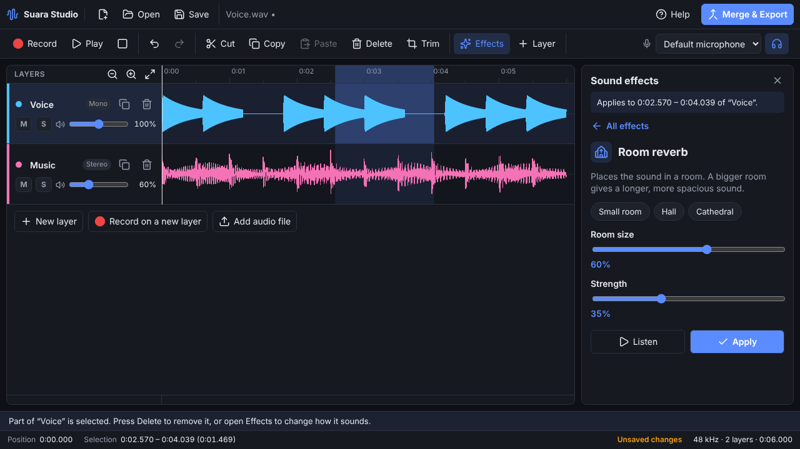

<p align="center">
  
</p>

<h1 align="center">Suara Studio</h1>

<p align="center">
  Record and edit audio in one desktop app for Windows, macOS and Linux.<br>
  <em>Rekam dan edit audio dalam satu aplikasi.</em>
</p>

<p align="center">
  <a href="https://github.com/tenmaryut/suara-studio/actions/workflows/ci.yml"></a>
  <a href="https://github.com/tenmaryut/suara-studio/releases/latest"></a>
  <a href="LICENSE"></a>
</p>

<p align="center">
  <a href="#bahasa-indonesia">Bahasa Indonesia</a>
</p>


## Features

- **Layers**: stack as many layers as you need, such as a voice, a second take and background
  music. Each layer has its own volume (0–200%), mute and solo buttons, and can be renamed,
  duplicated or deleted.
- **Record** from any microphone, with a live level meter and a clipping warning. Record on a new
  layer while the other layers play along (use headphones), and the take lines up with what you
  heard. Audio is captured as-is: no echo cancellation, noise suppression or automatic gain.
- **Edit each layer**: select part of a layer with the mouse, then cut, copy, paste, delete or trim
  it, or record over it. Every change, including adding and deleting layers, can be undone.
- **18 sound effects** in five groups, each with simple sliders and a **Listen** button to hear the
  result before you apply it. Effects with several settings also offer presets, such as *Small
  room*, *Hall* and *Cathedral* for reverb.
- **Merge & Export** mixes every audible layer into one WAV file (16-bit, 24-bit or 32-bit float),
  with optional protection against clipping. Muted layers are left out.
- **Projects**: save your layers, volumes and names in a `.suara` project file and carry on later.
- **Open** WAV, MP3, FLAC, Ogg (Vorbis/Opus) and M4A/AAC, or drop files on the window to add them as
  layers. WAV files are read sample-for-sample.
- **Made for beginners**: a start screen with the three steps, a hint bar that says what you can do
  next, and a built-in guide (<kbd>F1</kbd>). English and Indonesian interface, light and dark
  themes, and a notice when a new version is out.



| Group | Effects |
| --- | --- |
| Volume | Change volume, normalize, fade in, fade out, silence |
| Fix the sound | Remove rumble, remove background hiss, even out volume, shorten long pauses |
| Tone | Boost bass, boost treble, telephone voice |
| Space and echo | Echo, room reverb |
| Creative | Change speed, robot voice, tremolo, reverse |

## Getting started

1. **Record** or **Open file**. Each recording or file becomes a layer.
2. Add more layers with **Record on a new layer** or **Add audio file**, and set each layer's volume
   with its slider. **M** mutes a layer and **S** plays it on its own.
3. Click a layer to work on it. Drag across it to select a part, then use **Cut**, **Delete**,
   **Trim** or **Effects**. Without a selection, an effect changes the whole layer (fades change
   its start or end).
4. Press **Merge & Export** to save all layers as one WAV file. Use **Save** to keep the project
   with its layers for later.

Press **Help** or <kbd>F1</kbd> in the app for the same steps and the keyboard shortcuts.

## Install

### macOS and Linux

```sh
curl -fsSL https://github.com/tenmaryut/suara-studio/releases/latest/download/install.sh | sh
```

- **macOS** (Apple silicon and Intel): installs `Suara Studio.app` into `/Applications`, or
  `~/Applications` if `/Applications` is not writable.
- **Linux** (x64): uses the `.deb` package on Debian and Ubuntu and the `.rpm` package on Fedora and
  openSUSE, and asks for your password to install it. On other distributions, or without `sudo`, it
  installs for your user only into `~/.local`.

Options go after `sh -s --`:

```sh
curl -fsSL https://github.com/tenmaryut/suara-studio/releases/latest/download/install.sh | sh -s -- --version v0.1.0
```

| Option | What it does |
| --- | --- |
| `--version vX.Y.Z` | Install a specific release instead of the latest |
| `--method deb\|rpm\|tarball` | Linux: choose the package type (`tarball` needs no `sudo`) |
| `--prefix DIR` | Linux tarball install location (default `~/.local`) |
| `--app-dir DIR` | macOS install folder (default `/Applications`) |
| `--dry-run` | Download and verify, but don't install |
| `--uninstall` | Remove Suara Studio (your recordings are not touched) |

### Windows

Run in PowerShell:

```powershell
irm https://github.com/tenmaryut/suara-studio/releases/latest/download/install.ps1 | iex
```

It installs Suara Studio for the current user, with no administrator rights needed, and adds it to
the Start menu. To pass options, set environment variables first, for example
`$env:SUARA_VERSION = 'v0.1.0'` or `$env:SUARA_UNINSTALL = '1'`.

### Manual download

Every [release](https://github.com/tenmaryut/suara-studio/releases) has installers for each system:
`.exe` (Windows), `.dmg` and `.zip` (macOS), and `.deb`, `.rpm`, `.AppImage` and `.tar.gz` (Linux).
It also has a `SHA256SUMS.txt` file to check your download against:

```sh
sha256sum --check --ignore-missing SHA256SUMS.txt
```

The install scripts do this check for you, and stop if any file does not match.

### About unsigned builds

The installers are not yet signed with an Apple or Microsoft certificate. The install commands
above avoid the prompts below, which only appear if you download an installer with a browser:

- **macOS:** the first time you open the app, macOS blocks it. Choose **Done**, open
  **System Settings** → **Privacy & Security**, and choose **Open Anyway** next to the message about
  Suara Studio. If macOS says the app "is damaged", run
  `xattr -dr com.apple.quarantine "/Applications/Suara Studio.app"` and open it again.
- **Windows:** if SmartScreen appears, choose **More info**, then **Run anyway**.

On Windows 11, **Smart App Control** blocks unsigned apps however they are installed, and it has no
exception for a single app. To use Suara Studio, turn it off in **Windows Security** →
**App & browser control** → **Smart App Control settings**.

A step-by-step guide in Indonesian covers every system:
[docs/panduan-unduh.md](docs/panduan-unduh.md).

## Keyboard shortcuts

On macOS, use <kbd>⌘</kbd> wherever <kbd>Ctrl</kbd> is listed.

| Action | Shortcut |
| --- | --- |
| Record / finish recording | <kbd>R</kbd> or <kbd>Ctrl</kbd>+<kbd>R</kbd> |
| Record on a new layer | <kbd>Ctrl</kbd>+<kbd>Shift</kbd>+<kbd>R</kbd> |
| Play / pause | <kbd>Space</kbd> |
| Stop playback, or clear the selection | <kbd>Esc</kbd> |
| Choose the layer above / below | <kbd>↑</kbd> / <kbd>↓</kbd> |
| Move the cursor 1 second (with <kbd>Shift</kbd>: 0.1 second) | <kbd>←</kbd> / <kbd>→</kbd> |
| Go to start / end | <kbd>Home</kbd> / <kbd>End</kbd> |
| Undo / redo | <kbd>Ctrl</kbd>+<kbd>Z</kbd> / <kbd>Ctrl</kbd>+<kbd>Shift</kbd>+<kbd>Z</kbd> |
| Cut / copy / paste | <kbd>Ctrl</kbd>+<kbd>X</kbd> / <kbd>Ctrl</kbd>+<kbd>C</kbd> / <kbd>Ctrl</kbd>+<kbd>V</kbd> |
| Delete the selection | <kbd>Delete</kbd> or <kbd>Backspace</kbd> |
| Select the whole layer / trim to the selection | <kbd>Ctrl</kbd>+<kbd>A</kbd> / <kbd>Ctrl</kbd>+<kbd>T</kbd> |
| New layer / duplicate layer | <kbd>Ctrl</kbd>+<kbd>Shift</kbd>+<kbd>N</kbd> / <kbd>Ctrl</kbd>+<kbd>D</kbd> |
| Add an audio file as a layer | <kbd>Ctrl</kbd>+<kbd>I</kbd> |
| Sound effects | <kbd>Ctrl</kbd>+<kbd>Shift</kbd>+<kbd>E</kbd> |
| Merge & export | <kbd>Ctrl</kbd>+<kbd>E</kbd> |
| Zoom in / out / fit | <kbd>Ctrl</kbd>+<kbd>=</kbd> / <kbd>Ctrl</kbd>+<kbd>-</kbd> / <kbd>Ctrl</kbd>+<kbd>0</kbd>, or <kbd>Ctrl</kbd> + scroll |
| New / open / save / save as | <kbd>Ctrl</kbd>+<kbd>N</kbd> / <kbd>Ctrl</kbd>+<kbd>O</kbd> / <kbd>Ctrl</kbd>+<kbd>S</kbd> / <kbd>Ctrl</kbd>+<kbd>Shift</kbd>+<kbd>S</kbd> |
| Guide | <kbd>F1</kbd> |

## Development

You need Node.js 22 or newer.

```sh
npm ci
npm run dev          # start the app with hot reload
npm test             # unit tests (Vitest)
npm run test:e2e     # end-to-end tests that drive the real app (needs a display; use xvfb-run on Linux)
npm run lint
npm run typecheck
npm run dist         # build installers for the current system into dist/
```

| Folder | Contents |
| --- | --- |
| `src/main` | Electron main process: window, menus, file dialogs, microphone permission, update check |
| `src/preload` | The small, typed API the page is allowed to call (`window.suara`) |
| `src/renderer` | The app UI: layer timeline, recorder, player, effects and the project model |
| `src/shared` | Code used on both sides: IPC types, translations, version comparison |
| `scripts` | Install scripts, icon and screenshot generators |
| `tests` | Unit, end-to-end and install-script tests |

The project model, effects and audio code (`src/renderer/src/project`, `src/renderer/src/effects`
and `src/renderer/src/audio`) have no dependency on Electron or the browser, apart from the
recorder, player and decoder, so their unit tests run in plain Node.

## Releasing

1. Set the new version in `package.json` (`npm version 0.3.0 --no-git-tag-version`) and describe the
   changes under a `## [0.3.0]` heading in [CHANGELOG.md](CHANGELOG.md).
2. Merge to `main`. On GitHub, open **Actions** → **Release** → **Run workflow**, and run it on
   `main`. The workflow creates the tag `v0.3.0` for the version in `package.json`. If you prefer
   git, you can push the tag yourself instead:

   ```sh
   git tag v0.3.0
   git push origin v0.3.0
   ```

3. The [Release workflow](.github/workflows/release.yml) builds the installers on Windows, macOS and
   Linux, installs and starts each one, then creates a **draft** release with the installers, both
   install scripts and `SHA256SUMS.txt`.
4. Check the draft on GitHub and press **Publish release**. The install commands always fetch the
   latest published release.

## Bahasa Indonesia

Suara Studio adalah aplikasi untuk merekam dan mengedit audio di Windows, macOS, dan Linux.


**Cara memasang**

- macOS dan Linux, jalankan di Terminal:

  ```sh
  curl -fsSL https://github.com/tenmaryut/suara-studio/releases/latest/download/install.sh | sh
  ```

- Windows, jalankan di PowerShell:

  ```powershell
  irm https://github.com/tenmaryut/suara-studio/releases/latest/download/install.ps1 | iex
  ```

Panduan lengkap langkah demi langkah, termasuk unduhan manual, izin mikrofon, dan cara mengatasi
masalah, ada di **[Panduan Unduh dan Pasang](docs/panduan-unduh.md)**.

Skrip instalasi selalu memeriksa setiap file dengan `SHA256SUMS.txt` sebelum memasang. Untuk
menghapus aplikasi, tambahkan `--uninstall` di macOS/Linux
(`curl -fsSL … | sh -s -- --uninstall`). Di Windows, jalankan `$env:SUARA_UNINSTALL = '1'` sebelum
perintah di atas. Rekaman Anda tidak ikut terhapus.

**Fitur utama**

- **Layer:** tumpuk layer sebanyak yang dibutuhkan, misalnya vokal, rekaman kedua, dan musik latar.
  Tiap layer punya volume sendiri (0–200%), tombol bisukan (M) dan solo (S), dan bisa diganti nama,
  digandakan, atau dihapus.
- **Rekam** dari mikrofon dengan indikator level. Saat merekam di layer baru, layer lain ikut
  diputar (pakai headphone) dan hasil rekaman langsung pas dengan yang Anda dengar.
- **Edit tiap layer:** pilih bagian dengan mouse, lalu potong, salin, tempel, hapus, pangkas, atau
  rekam ulang. Semua perubahan bisa diurungkan.
- **18 efek suara** dalam lima kelompok: volume, perbaiki suara, warna suara, ruang & gema, dan
  kreatif. Tiap efek punya slider sederhana dan tombol **Dengarkan** untuk mencoba sebelum
  diterapkan.
- **Gabungkan & Ekspor** menggabungkan semua layer yang terdengar menjadi satu file WAV (16-bit,
  24-bit, atau 32-bit float). Layer yang dibisukan tidak ikut.
- **Proyek** `.suara` menyimpan semua layer, volume, dan nama, jadi bisa dilanjutkan nanti.
- Bisa membuka WAV, MP3, FLAC, OGG, dan M4A. Bahasa tampilan mengikuti bahasa sistem (Indonesia atau
  Inggris).

**Cara memakai**

1. Tekan **Rekam** atau **Buka file**. Setiap rekaman atau file menjadi satu layer.
2. Tambah layer dengan **Rekam di layer baru** atau **Tambah file audio**, lalu atur volume tiap
   layer dengan slidernya.
3. Klik layer yang ingin diedit. Seret di atasnya untuk memilih bagian, lalu pakai **Potong**,
   **Hapus**, **Pangkas**, atau **Efek**. Tanpa pilihan, efek mengubah seluruh layer (fade in/out
   mengubah awal atau akhirnya).
4. Tekan **Gabungkan & Ekspor** untuk menyimpan semua layer sebagai satu file WAV. Tekan **Simpan**
   untuk menyimpan proyek beserta layernya.

Tekan **Bantuan** atau <kbd>F1</kbd> di aplikasi untuk melihat langkah-langkah ini dan daftar pintasan
keyboard.

## License

[MIT](LICENSE) © 2026 tenmaryut
