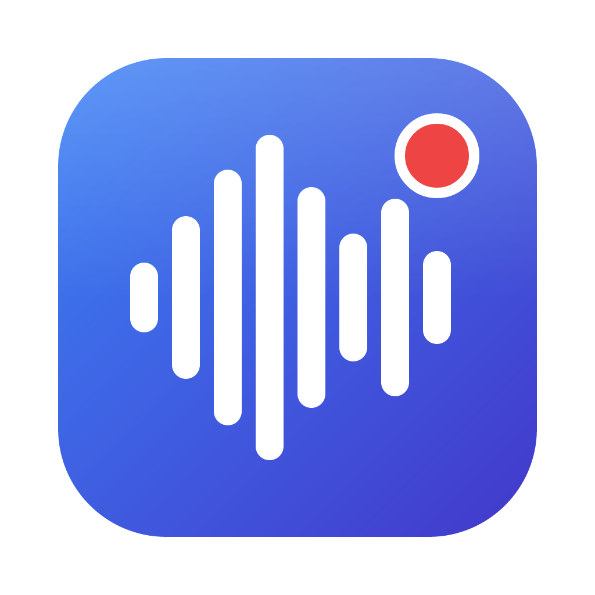
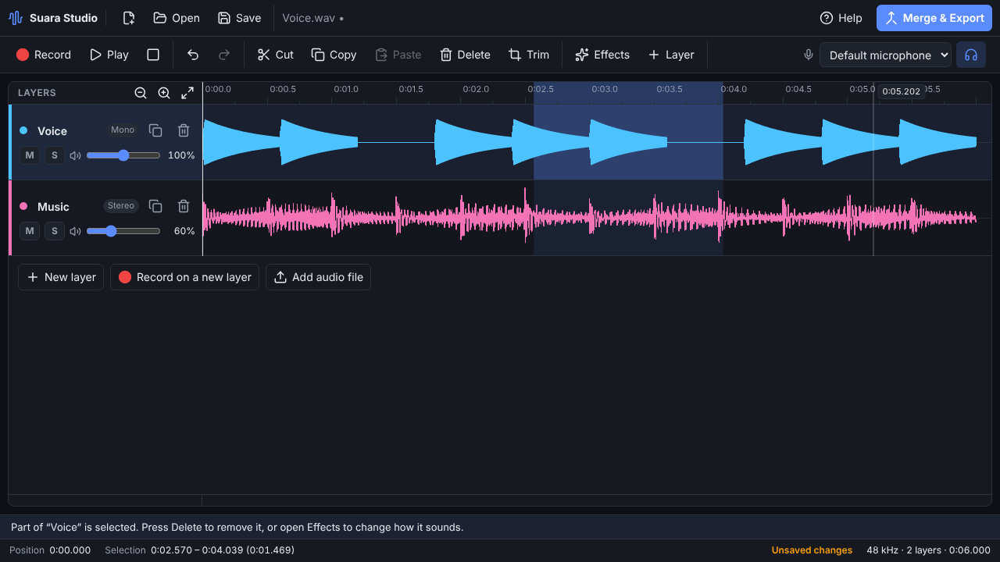
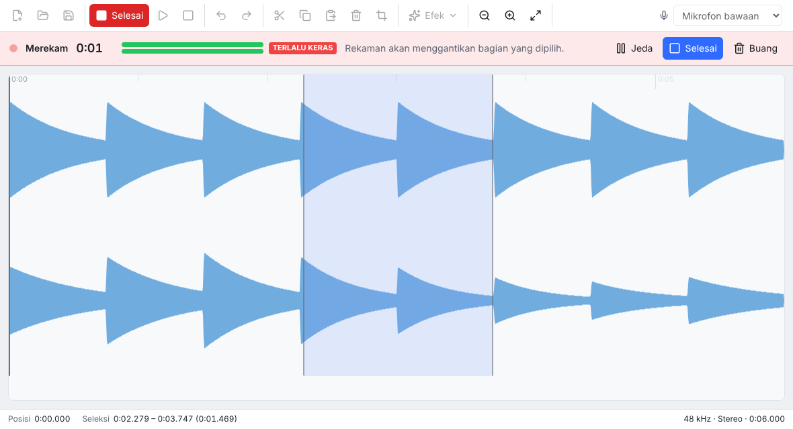

<p align="center">
  
</p>

<h1 align="center">Suara Studio</h1>

<p align="center">
  Record and edit audio in one desktop app for Windows, macOS and Linux.<br>
  <em>Rekam dan edit audio dalam satu aplikasi.</em>
</p>

<p align="center">
  <a href="https://github.com/tenmaryut/suara-studio/actions/workflows/ci.yml"></a>
  <a href="https://github.com/tenmaryut/suara-studio/releases/latest"></a>
  <a href="LICENSE"></a>
</p>

<p align="center">
  <a href="#bahasa-indonesia">Bahasa Indonesia</a>
</p>



## Features

- **Record** from any microphone, with a live level meter, a clipping warning, and pause and resume.
  Audio is captured as-is: no echo cancellation, noise suppression or automatic gain.
- **Record into a project**: a new take is inserted at the cursor, or replaces the selected part.
- **Edit on the waveform**: select with the mouse, zoom with <kbd>Ctrl</kbd> + scroll, and play the
  whole file or just the selection.
- **Cut, copy, paste, delete and trim**, plus **fade in, fade out, normalize, amplify, silence and
  reverse**. Every change can be undone.
- **Open** WAV, MP3, FLAC, Ogg (Vorbis/Opus) and M4A/AAC. WAV files are read sample-for-sample at
  their own sample rate.
- **Save** WAV as 16-bit, 24-bit or 32-bit float.
- English and Indonesian interface, light and dark themes, and a notice when a new version is out.

## Install

### macOS and Linux

```sh
curl -fsSL https://github.com/tenmaryut/suara-studio/releases/latest/download/install.sh | sh
```

- **macOS** (Apple silicon and Intel): installs `Suara Studio.app` into `/Applications`, or
  `~/Applications` if `/Applications` is not writable.
- **Linux** (x64): uses the `.deb` package on Debian and Ubuntu and the `.rpm` package on Fedora and
  openSUSE, and asks for your password to install it. On other distributions, or without `sudo`, it
  installs for your user only into `~/.local`.

Options go after `sh -s --`:

```sh
curl -fsSL https://github.com/tenmaryut/suara-studio/releases/latest/download/install.sh | sh -s -- --version v0.1.0
```

| Option | What it does |
| --- | --- |
| `--version vX.Y.Z` | Install a specific release instead of the latest |
| `--method deb\|rpm\|tarball` | Linux: choose the package type (`tarball` needs no `sudo`) |
| `--prefix DIR` | Linux tarball install location (default `~/.local`) |
| `--app-dir DIR` | macOS install folder (default `/Applications`) |
| `--dry-run` | Download and verify, but don't install |
| `--uninstall` | Remove Suara Studio (your recordings are not touched) |

### Windows

Run in PowerShell:

```powershell
irm https://github.com/tenmaryut/suara-studio/releases/latest/download/install.ps1 | iex
```

It installs Suara Studio for the current user, with no administrator rights needed, and adds it to
the Start menu. To pass options, set environment variables first, for example
`$env:SUARA_VERSION = 'v0.1.0'` or `$env:SUARA_UNINSTALL = '1'`.

### Manual download

Every [release](https://github.com/tenmaryut/suara-studio/releases) has installers for each system:
`.exe` (Windows), `.dmg` and `.zip` (macOS), and `.deb`, `.rpm`, `.AppImage` and `.tar.gz` (Linux).
It also has a `SHA256SUMS.txt` file to check your download against:

```sh
sha256sum --check --ignore-missing SHA256SUMS.txt
```

The install scripts do this check for you, and stop if any file does not match.

### About unsigned builds

The installers are not yet signed with an Apple or Microsoft certificate. The install commands
above are not affected. If you download an installer with a browser instead:

- **macOS:** the first time you open the app, macOS blocks it. Choose **Done**, open
  **System Settings** → **Privacy & Security**, and choose **Open Anyway** next to the message about
  Suara Studio. If macOS says the app "is damaged", run
  `xattr -dr com.apple.quarantine "/Applications/Suara Studio.app"` and open it again.
- **Windows:** if SmartScreen appears, choose **More info**, then **Run anyway**.

A step-by-step guide in Indonesian covers every system:
[docs/panduan-unduh.md](docs/panduan-unduh.md).

## Keyboard shortcuts

On macOS, use <kbd>⌘</kbd> wherever <kbd>Ctrl</kbd> is listed.

| Action | Shortcut |
| --- | --- |
| Record / finish recording | <kbd>R</kbd> or <kbd>Ctrl</kbd>+<kbd>R</kbd> |
| Play / pause (pause while recording) | <kbd>Space</kbd> |
| Stop playback, or clear the selection | <kbd>Esc</kbd> |
| Undo / redo | <kbd>Ctrl</kbd>+<kbd>Z</kbd> / <kbd>Ctrl</kbd>+<kbd>Shift</kbd>+<kbd>Z</kbd> |
| Cut / copy / paste | <kbd>Ctrl</kbd>+<kbd>X</kbd> / <kbd>Ctrl</kbd>+<kbd>C</kbd> / <kbd>Ctrl</kbd>+<kbd>V</kbd> |
| Delete the selection | <kbd>Delete</kbd> or <kbd>Backspace</kbd> |
| Select all / trim to the selection | <kbd>Ctrl</kbd>+<kbd>A</kbd> / <kbd>Ctrl</kbd>+<kbd>T</kbd> |
| Zoom in / out / fit | <kbd>Ctrl</kbd>+<kbd>=</kbd> / <kbd>Ctrl</kbd>+<kbd>-</kbd> / <kbd>Ctrl</kbd>+<kbd>0</kbd>, or <kbd>Ctrl</kbd> + scroll |
| Go to start / end | <kbd>Home</kbd> / <kbd>End</kbd> |
| New / open / save / save as | <kbd>Ctrl</kbd>+<kbd>N</kbd> / <kbd>Ctrl</kbd>+<kbd>O</kbd> / <kbd>Ctrl</kbd>+<kbd>S</kbd> / <kbd>Ctrl</kbd>+<kbd>Shift</kbd>+<kbd>S</kbd> |

## Development

You need Node.js 22 or newer.

```sh
npm ci
npm run dev          # start the app with hot reload
npm test             # unit tests (Vitest)
npm run test:e2e     # end-to-end tests that drive the real app (needs a display; use xvfb-run on Linux)
npm run lint
npm run typecheck
npm run dist         # build installers for the current system into dist/
```

| Folder | Contents |
| --- | --- |
| `src/main` | Electron main process: window, menus, file dialogs, microphone permission, update check |
| `src/preload` | The small, typed API the page is allowed to call (`window.suara`) |
| `src/renderer` | The app UI: recorder, waveform editor, effects |
| `src/shared` | Code used on both sides: IPC types, translations, version comparison |
| `scripts` | Install scripts, icon and screenshot generators |
| `tests` | Unit, end-to-end and install-script tests |

The audio editing code (`src/renderer/src/audio` and `src/renderer/src/editor`) has no dependency
on Electron or the browser, so its unit tests run in plain Node.

## Releasing

1. Set the new version in `package.json` (`npm version 0.2.0 --no-git-tag-version`) and describe the
   changes under a `## [0.2.0]` heading in [CHANGELOG.md](CHANGELOG.md).
2. Merge to `main`, then tag the commit and push the tag:

   ```sh
   git tag v0.2.0
   git push origin v0.2.0
   ```

3. The [Release workflow](.github/workflows/release.yml) builds the installers on Windows, macOS and
   Linux, installs and starts each one, then creates a **draft** release with the installers, both
   install scripts and `SHA256SUMS.txt`.
4. Check the draft on GitHub and press **Publish release**. The install commands always fetch the
   latest published release.

## Bahasa Indonesia

Suara Studio adalah aplikasi untuk merekam dan mengedit audio di Windows, macOS, dan Linux.



**Cara memasang**

- macOS dan Linux, jalankan di Terminal:

  ```sh
  curl -fsSL https://github.com/tenmaryut/suara-studio/releases/latest/download/install.sh | sh
  ```

- Windows, jalankan di PowerShell:

  ```powershell
  irm https://github.com/tenmaryut/suara-studio/releases/latest/download/install.ps1 | iex
  ```

Panduan lengkap langkah demi langkah, termasuk unduhan manual, izin mikrofon, dan cara mengatasi
masalah, ada di **[Panduan Unduh dan Pasang](docs/panduan-unduh.md)**.

Skrip instalasi selalu memeriksa setiap file dengan `SHA256SUMS.txt` sebelum memasang. Untuk
menghapus aplikasi, tambahkan `--uninstall` di macOS/Linux
(`curl -fsSL … | sh -s -- --uninstall`). Di Windows, jalankan `$env:SUARA_UNINSTALL = '1'` sebelum
perintah di atas. Rekaman Anda tidak ikut terhapus.

**Fitur utama:** rekam dari mikrofon dengan indikator level, sisipkan rekaman di posisi kursor atau
ganti bagian yang dipilih, lalu edit (potong, salin, tempel, hapus, pangkas, fade in/out,
normalisasi, perkuat, senyapkan, balik) dengan undo/redo. Bisa membuka WAV, MP3, FLAC, OGG, dan M4A,
lalu menyimpan sebagai WAV 16-bit, 24-bit, atau 32-bit float. Bahasa tampilan mengikuti bahasa
sistem (Indonesia atau Inggris).

## License

[MIT](LICENSE) © 2026 tenmaryut
